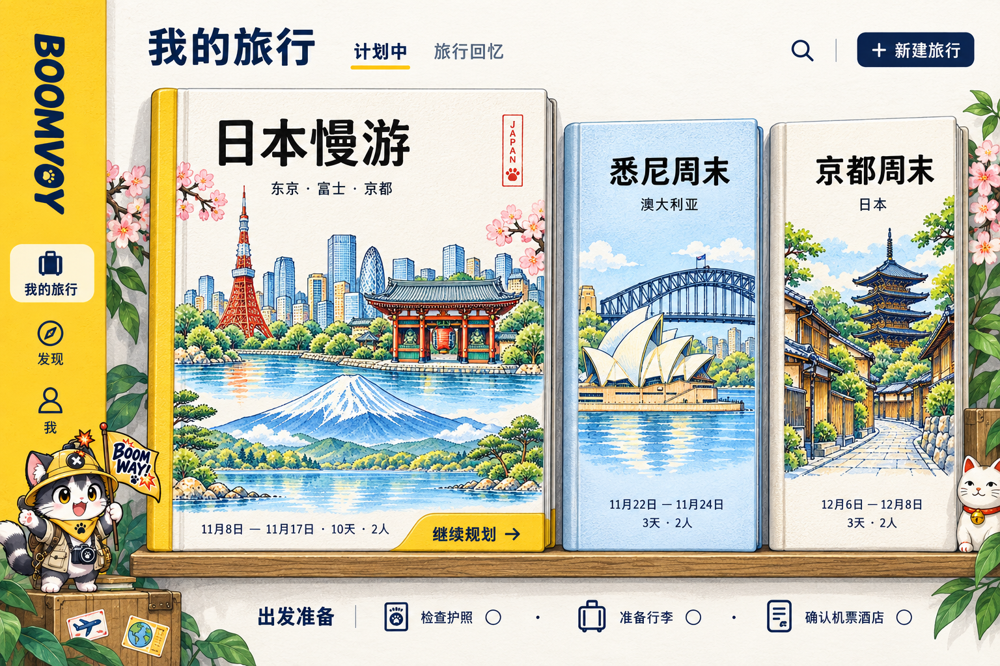
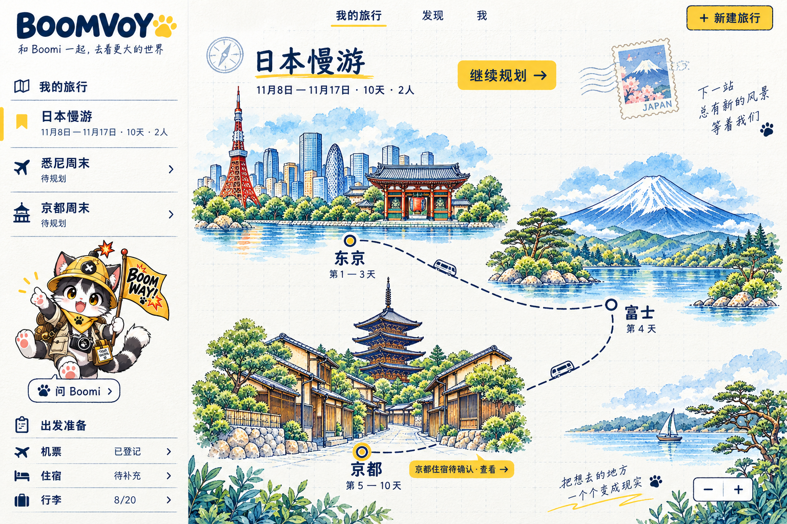
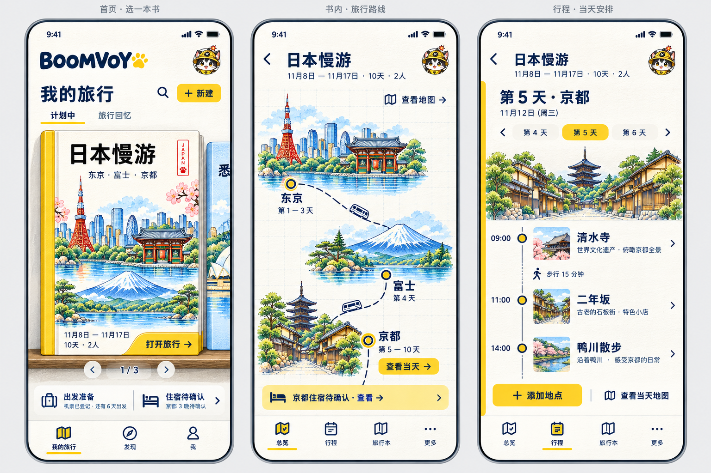

# BOOMVOY 已确认的页面设计方向

确认日期为 2026-10-17（Australia/Sydney）。2026-11-25 已实现城市口袋书主页、插画路线总览、手机纵向路线、当天插画页头，以及带分类和搜索的目的地图册。下文保留方案确认时的设计依据和验收要求。

BOOMVOY 的下一轮改版采用 **D 城市口袋书作为主页，E 路线画布作为每本旅行的内部**。手机版采用本文附图中的选书、旅行路线和当天行程三个层次。保留已有城市、地标水彩素材和原 Boomi，让封面、路线与旅行内容形成连续体验。

用户已明确选择「主页是 d，点开每一本是 e」，并确认「手机版这样也可以」。本次先保存方案，过几天再修改页面；现在不开始产品代码实施。下次继续时直接以本页和三张附件为依据，无需重新挑选风格。

## 已确定的页面分工

| 页面 | 已选方案 | 主要用途 |
| --- | --- | --- |
| 桌面主页 | D 城市口袋书 | 浏览自己的旅行，挑选并打开一本书 |
| 桌面旅行内页 | E 路线画布 | 浏览这趟旅行的城市、停留日期和路线，进入当天安排 |
| 手机主页 | D 的手机布局 | 单本封面为主，左右换书，提供搜索与分类入口 |
| 手机旅行总览 | E 的纵向布局 | 向下浏览城市路线，点击城市进入对应日期 |
| 手机当天行程 | 手机附图右屏 | 切换日期，查看和编辑当天地点，进入地图 |
| 旅行本及其他功能 | 延续已有功能和数据 | 清单、票夹、随记及原有旅行工具继续可达，按同一风格细化 |

第一轮 A／B／C 不作为本次改版方向。第二轮 F 旅行标本册未被选为主界面。发现页、个人页、独立旅行本等尚未确定最终构图，后续沿用本页的视觉语言，不把旧探索图直接当成已确认稿。

## 桌面主页采用 D 城市口袋书

每趟旅行对应一本有自己封面的书。城市插画、旅行名称、日期、天数和人数组成封面，点击书本即可打开这趟旅行。保留黄色书脊、墨蓝文字、纸页边缘和书本排列的收藏感；封面上的打开或继续入口需要清楚可见。

页面提供新建、搜索和旅行分类。旅行较多时允许滚动浏览，并能通过名称、目的地与状态定位，不能只靠逐本翻找。没有旅行时用同一套书本语言提供新建入口，搜索无结果时提供清除条件。

图中的书本入口、插画封面和整体气质是已选方向。木架纹理、花叶、行李箱、额外招财猫和厚重书体属于示意图细节，后续可减量，不需要逐项复制。

## 桌面旅行内页采用 E 路线画布

打开书本后，显示当前旅行的插画路线。城市素材分别保持完整，路线点、连线、城市名和停留日期共同组织内容。点击城市可以进入对应日期或当天行程，当前选择具有明确的强调状态。

侧边区域承担旅行切换、准备事项和必要操作；城市路线是主画面。完整地图、日期切换、地点编辑、清单和票据继续使用已有功能。插画路线用于表达旅行顺序，实际地图与交通信息由真实地点及行程数据提供。

封面与内页复用同一套目的地素材，形成打开同一本旅行书的连续感。全球目的地均按目录匹配；日本是图中示例，不限制产品服务范围。城市多时应有可定位的浏览方式，避免把全部插画缩小后挤进首屏。

原稿中的手写口号、邮票、外围装饰、字标爪印及新增图标不是必须实现项。原 Boomi 身份保持一致，具体大小与位置根据可用空间调整。

## 手机版采用已确认的三屏方案

### 主页选一本旅行书

一次突出一本完整封面，旁边露出下一本。左右滑动换书，同时提供显式切换按钮；封面显示名称、目的地、日期和打开入口。顶部提供搜索、新建及小型 Boomi 入口，下方显示紧凑的出发准备提示。

全局底部导航保持「我的旅行／发现／我」。书本的高度、厚度和边缘装饰需要按手机空间调整，保证常用操作容易找到。

### 书内浏览纵向路线

城市插画沿着纵向路线展开，城市名、停留日期和点击入口保持正常可读大小。用户向下滚动查看整条路线，点击城市进入相应日期；长路线保留快速回到当前城市或日期的方式。

旅行内底部导航为「总览／行程／旅行本／更多」。Boomi 放在顶栏预留位置，待处理事项以紧凑提示显示，给路线与主要操作留足空间。

### 当天查看和调整行程

城市插画成为紧凑的章节页头，下面提供日期切换与时间线。每一站显示时间、地点和必要说明，支持打开地点、添加地点和查看当天地图。底部四项导航与总览一致，在当天页面选中「行程」。

旅行本继续组织「清单／票夹／随记」。详细清单、预订、笔记、打卡以及更多旅行工具复用已有数据与入口，不能因视觉改版丢失。

## 统一的视觉语言

| 项目 | 方向 |
| --- | --- |
| 整体感觉 | 有作者气质的旅行书与插画路线，保持可阅读、可操作 |
| 色彩 | 黄色承担品牌强调、书脊和当前选择，墨蓝承担文字与线条，纸白作为底面，城市插画提供风景色彩 |
| 字体 | 标题有明确个性和层次，正文、日期、时间与按钮使用清晰的中英文字体 |
| 素材 | 继续使用已有细墨线与水彩城市、地标、通用风景，保留完整轮廓和透明边缘 |
| 纸品 | 书封、页边、书签和路线承担具体内容，纸纹及阴影保持适量 |
| Boomi | 保留原黑白猫、黄色探险帽与围巾、探险服和相机身份，提供稳定入口 |
| 文案 | 优先旅行名称、地点、日期、状态和操作，避免增加宣传口号和重复说明 |
| 动效 | 可用简短的封面展开与插画位置过渡连接两页，尊重减少动态效果设置 |

精确色值、字号、字体文件、书架尺寸、插画比例、动画时长和最终交互参数在实施时通过实际页面确定。本次确认的是风格与页面分工。

## 已有素材的使用方式

实施时直接引用仓库中的原素材文件，不从概念图裁切或采用被重新绘制的城市与角色。当前目录为 171 张插画，含 77 张城市与地区、90 张地标、4 张通用风景；以后增加素材继续沿用对应目录。

| 内容 | 项目位置 |
| --- | --- |
| 网页运行素材 | `src/assets/illustrations/` 下的 480px 与 960px WebP |
| 本地 PNG 母版 | `output/illustration-masters/` |
| 素材清单与匹配 | `docs/illustration-assets.json`、`src/illustrationCatalog.ts` 及目的地和景点目录 |
| 插画展示组件 | `src/DestinationArt.tsx` |
| 原 Boomi | `src/assets/boomi.png`、`src/assets/boomi_icon.png` |
| 可搜索素材目录 | `output/illustration-library/index.html` |

生成图会重绘部分细节，因此三张附件是构图和气质依据，不是新的运行素材。图中的日期、星期、订单状态、路线天数和交通说明都是布局示例；正式界面从真实数据计算和展示。不同城市应各自保留独立插画，通过连线表达顺序。

## 下次实施的顺序与验收

1. 先检查工作区和现有未提交修改，读取本页、HANDOFF 和相关页面，确认素材匹配及导航仍然可用。
2. 先做 D 主页及手机选书布局，检查单趟、多趟、空列表、搜索和长名称。
3. 做 E 旅行总览及手机纵向路线，接通城市、日期和当前选择状态，覆盖少量城市与长路线。
4. 衔接手机当天行程和旅行本入口，保留原地图、编辑、清单、票夹、随记及其他工具的功能和数据。
5. 统一中英文、Boomi、纸品材质和页面过渡，再完成必要回归与构建。

桌面与手机都检查字号、控件边界、图片加载和底部留白。手机按 360／390／768px、桌面按 1024／1440px 检查布局；主要触达区域以至少 44px 为实施目标，支持键盘焦点、减少动态效果和安全区。构建与浏览器检查通过后，仍需分别记录真机检查结果。

本次仅整理文档与附图，产品代码没有按 D／E 方案实施。没有提交或推送，也没有设置未来自动修改任务；用户过几天回来后再继续。

## 页面改好后同步到 GitHub

用户已补充要求：本轮页面改版完成后，继续提交并推送到 GitHub。该要求适用于后续按本文实施的改动；页面仍等用户过几天回来后再开始。

完成实现、必要回归和构建后，同步更新设计记录与 HANDOFF，将本轮相关代码、文档及所需图片提交并推送到项目仓库。只收录本轮授权范围，保留其他未提交修改；发布前重新检查远程、当前分支和远端更新，发生冲突时先妥善整合，不强制推送。

当前仓库为 `BAIX827/BOOMVOY`，远程 `origin` 是 `https://github.com/BAIX827/BOOMVOY.git`，本次记录时分支为 `main`。真正推送时再次核实目标；完成后比较本地 HEAD、远程跟踪分支和 `git ls-remote` 返回的提交号，确认 GitHub 已更新，再报告提交号和验证结果。

## 附图与历史记录

三张已选图片已复制到本页旁的 `design-references/approved-2026-10-17/`，正文使用相对路径嵌入，随项目目录一起保留即可阅读。

| 已选图片 | 本文附件 | 最初文件 |
| --- | --- | --- |
| D 桌面主页 | `desktop-home-d.png` | `output/design-concepts/2026-10-16/round-02/d-pocket-travel-books.png` |
| E 桌面旅行内页 | `desktop-trip-e.png` | `output/design-concepts/2026-10-16/round-02/e-illustrated-route-canvas.png` |
| 手机三屏 | `mobile-books-route-day.png` | `output/design-concepts/2026-10-17/mobile-books-route-day.png` |

更早的探索及已实施状态保留在 [设计风格与插画素材实施计划](DESIGN_STYLE_AND_ASSET_PLAN.md)。后续改版方向以本页和用户之后的新指示为准。
